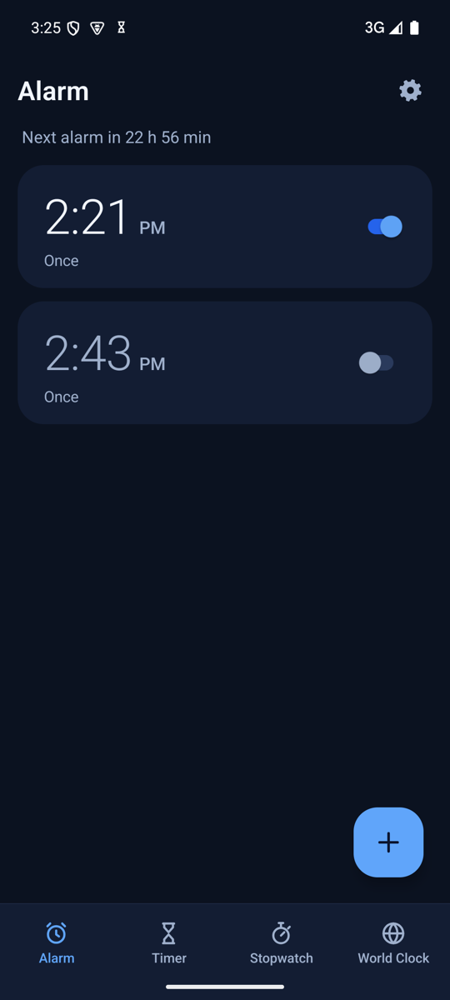
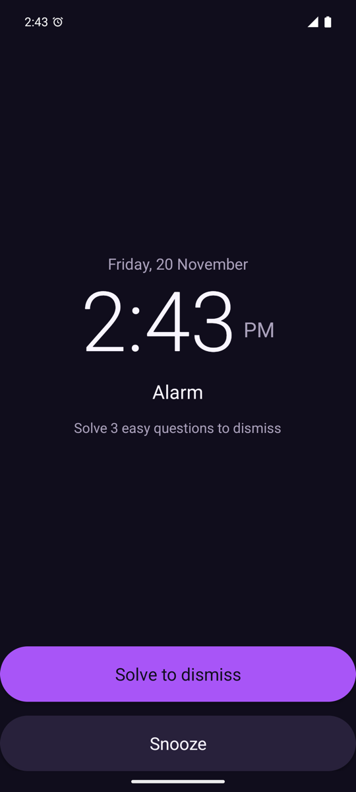
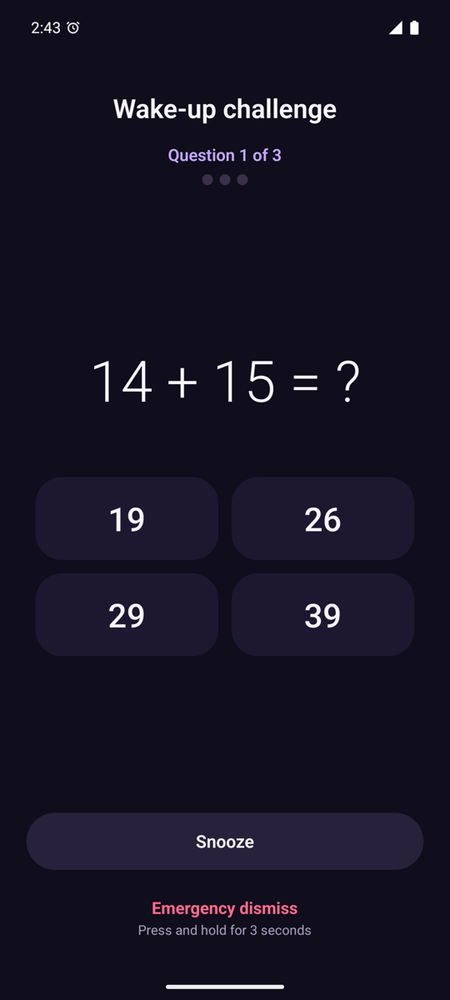
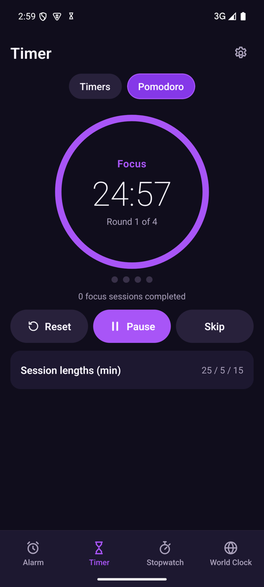
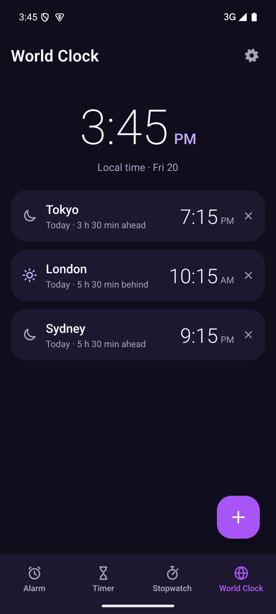
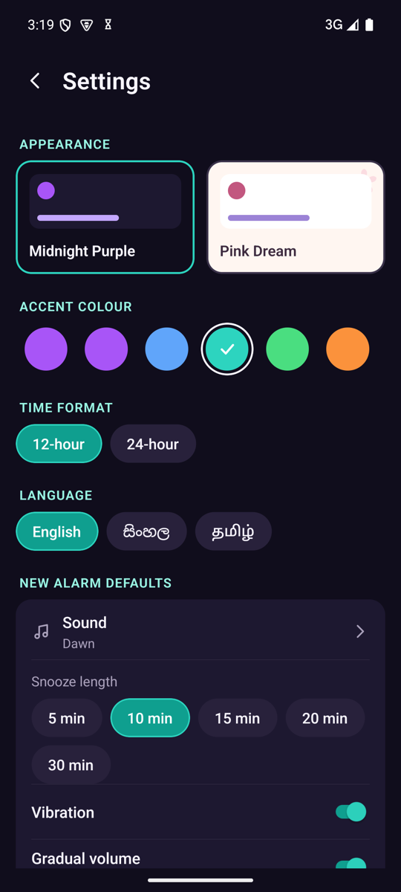
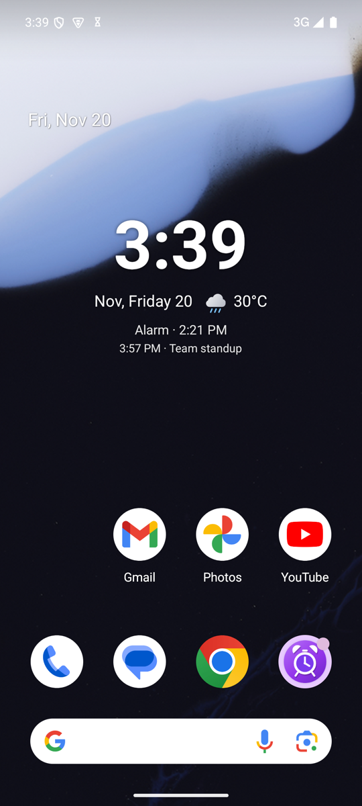
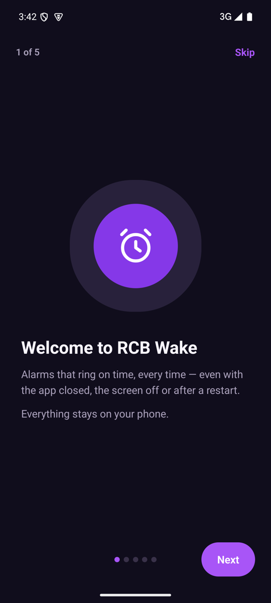

# RCB Wake

**Wake up your way.** A calm, reliable alarm clock for Android — with timers, a Pomodoro focus
timer, a stopwatch, a world clock and a home-screen clock widget. Offline-first and private.

<p>
  
  
  
  
</p>
<p>
  
  
  
  
</p>

## Features

- **Alarms that ring.** Scheduled by Android's alarm-clock API and handled by a native engine, so
  they ring with the app closed, the screen off, after a reboot, and across time-zone and clock
  changes.
- **Per-alarm settings.** Repeat days or one-time, label, built-in tones or your own audio file,
  vibration, gradual volume, snooze length.
- **Wake-up math challenge.** Easy, medium or hard questions you must solve to dismiss, with an
  always-available emergency dismiss.
- **Timers.** Several at once, with labels, presets and background completion.
- **Pomodoro.** Focus and break cycles with configurable lengths and auto-start.
- **Stopwatch.** Laps with fastest and slowest highlighted.
- **World clock.** About 100 cities, day/night, time difference, daylight-saving aware.
- **Bedtime reminder.** A nudge to go to bed based on your next alarm and sleep goal.
- **Home-screen widget.** Frameless, resizable clock with date, next alarm, text colour (white,
  Material You or accent), optional weather (Open-Meteo, or OpenWeatherMap with your own key, at an
  interval you choose) and next calendar event — plus an "My Day" widget with a time-of-day greeting, date, weather and
  next event (Google Calendar, RCB Calendar or any calendar on the device).
- **Themes.** Midnight Purple (default) and Pink Dream, plus accent colours.
- **Languages.** English, Sinhala, Tamil, German, Russian, Spanish, French, Portuguese, Hindi,
  Chinese (Simplified) and Japanese.

## Privacy

RCB Wake has no accounts, analytics, ads or tracking. Your alarms, timers, cities and settings stay
on your device and are excluded from cloud backup.

The **only** network use is the optional widget weather, which is **off by default**. When you turn
it on, the coordinates of the city you choose — or your approximate location (rounded to about
1 km) if you allow it — are sent to [Open-Meteo](https://open-meteo.com), or, if you choose it, to
[OpenWeatherMap](https://openweathermap.org) together with your own API key. Searching for a
village or suburb as the weather location sends only the typed text to Open-Meteo. Details:
[docs/security-privacy.md](docs/security-privacy.md).

## Permissions

| Permission | Why |
| --- | --- |
| Exact alarms (`USE_EXACT_ALARM`; `SCHEDULE_EXACT_ALARM` on Android 12) | Ring at the exact minute |
| Notifications | Ringing, snooze, timer, Pomodoro and bedtime notifications |
| Full-screen notifications | Show the alarm over the lock screen |
| Run at startup | Restore alarms after a reboot |
| Foreground service (media playback), vibrate, wake lock | Keep the alarm sounding |
| Internet | Optional widget weather only |
| Approximate location | Optional, only if you choose "Use my location" for weather |
| Calendar (read) | Optional, only if you show your next event on the widget |

## Technology

React Native 0.88 (New Architecture, TypeScript), React Navigation, Zustand, Reanimated,
react-native-svg — and a native Kotlin engine using `AlarmManager`, a foreground ringing service,
SQLite and `java.time`, connected through a TurboModule.

Read more in [docs/](docs/README.md): architecture, native alarm engine, module contract, data
storage, UI/UX, security and privacy, testing and release.

## Install

RCB Wake is not yet on an app store. Build it from source (below) or download an APK from the
repository's Releases page when available. Android 8.0 or newer is required.

## Build

Requirements: Node.js ≥ 22.11, Yarn 1.x, JDK 17, Android SDK (platform 37).

```sh
yarn install
yarn android            # debug build on a connected device or emulator
yarn test && yarn test:kotlin
```

Release builds and signing: [docs/release.md](docs/release.md).

## Help wanted — contributors and translators welcome

RCB Wake is maintained by one developer, and help is very welcome:

- **Translators** — the Sinhala, Tamil, German, Russian, Spanish, French, Portuguese, Hindi,
  Chinese and Japanese texts were written by the developer and would benefit from native
  speakers. New languages are welcome too. See *Translations* in [CONTRIBUTING.md](CONTRIBUTING.md).
- **Testers** — especially on Samsung, Xiaomi, OnePlus and other devices with aggressive battery
  savers: do alarms ring overnight with the screen locked?
- **Developers** — bug fixes, accessibility and new ideas. Open an issue first for larger changes.

## Contributing

Bug reports, translations and pull requests are welcome — see [CONTRIBUTING.md](CONTRIBUTING.md)
and the [Code of Conduct](CODE_OF_CONDUCT.md). Security issues: [SECURITY.md](SECURITY.md).

## License

RCB Wake is **dual-licensed**.

**Free for noncommercial use** under the [PolyForm Noncommercial License 1.0.0](LICENSE): personal
use, study, research, hobby projects, and use by educational institutions, charities, public
research and government organisations.

**A paid commercial license is required for any commercial use**, including internal company
tools, SaaS or hosted services, client work, and paid or monetised products. See
[COMMERCIAL_LICENSE.md](COMMERCIAL_LICENSE.md) to request a commercial license or to ask about
acquiring the project.

Copyright 2026 Rananjaya. See [NOTICE](NOTICE).

Third-party components remain under their own licenses: [THIRD_PARTY_NOTICES.md](THIRD_PARTY_NOTICES.md).
Weather data by [Open-Meteo.com](https://open-meteo.com) (CC BY 4.0), or by
[OpenWeather](https://openweathermap.org) when that provider is selected.
