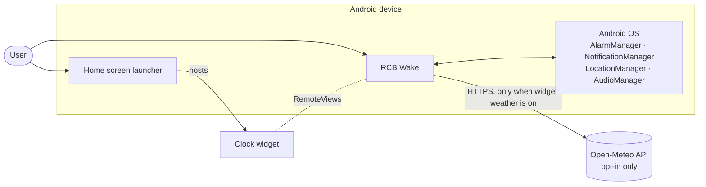
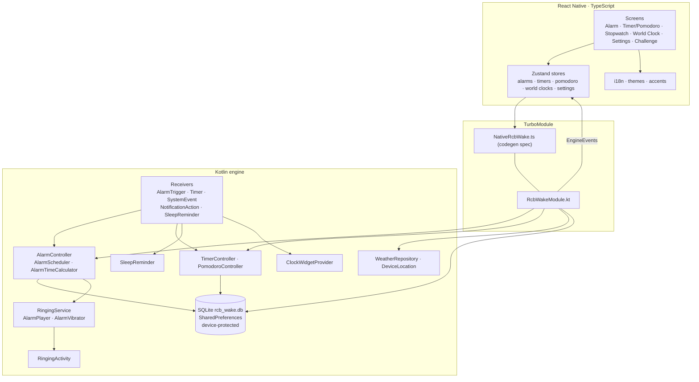
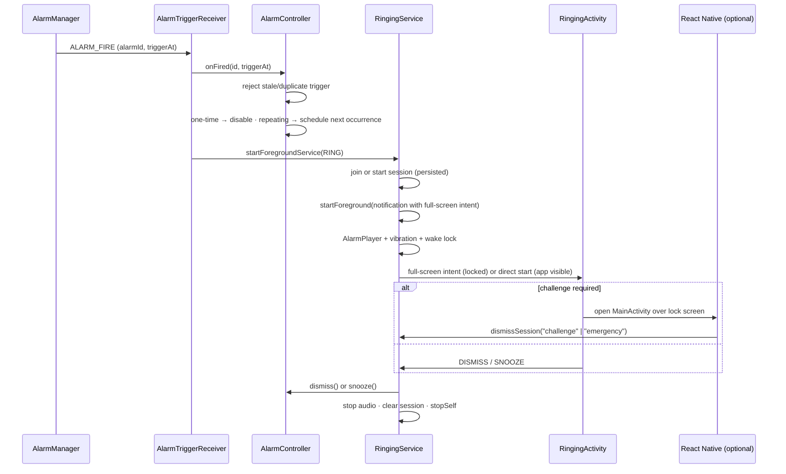

# Architecture

RCB Wake is a React Native app with a native Kotlin engine. The split is deliberate: everything
that must happen on time — alarms, snooze, timers, Pomodoro phases, bedtime reminders — runs in
Kotlin through Android's `AlarmManager` and works when the JavaScript runtime is not loaded at all.
React Native draws the UI and talks to the engine through one TurboModule.

## System context



## Layers



## Source layout

| Path | Contents |
| --- | --- |
| `src/app` | App root: engine bootstrap, event subscriptions, challenge routing |
| `src/navigation` | Bottom tabs + native stack |
| `src/features/*` | One folder per feature: `alarms`, `challenges`, `timer` (incl. Pomodoro), `stopwatch`, `worldclock`, `settings` |
| `src/components` | Shared UI (cards, chips, toggles, icons, toolbar) |
| `src/storage` | Zustand stores — thin views over native state |
| `src/native/NativeRcbWake.ts` | TurboModule contract (source of the generated Java spec) |
| `src/i18n` | English, Sinhala and Tamil strings, typed so every language has every key |
| `src/theme` | Midnight Purple, Pink Dream, accent colours |
| `android/app/src/main/java/com/rcb/wake/alarm` | Alarm model, validation, time maths, scheduler, controller, ringing session |
| `…/service`, `…/activity` | Ringing foreground service and full-screen activity |
| `…/audio` | Sound resolution, playback with fallback/gradual volume/audio focus, vibration |
| `…/timer` | Countdown timers and Pomodoro |
| `…/sleep` | Bedtime reminder |
| `…/weather`, `…/widget` | Opt-in weather, coarse location, home-screen widget |
| `…/receiver` | All broadcast receivers |
| `…/storage` | SQLite helper, repositories, settings |
| `…/module` | TurboModule implementation and in-process event bus |
| `scripts/` | Reproducible asset generators (tones, weather icons) |

## Single source of truth

There is exactly one persistent store, owned by Kotlin:

- **SQLite** (`rcb_wake.db`) — alarms, timers, world clocks. See [database.md](database.md).
- **SharedPreferences** — settings, and small runtime state (ringing session, Pomodoro, stopwatch,
  challenge progress, cached weather, coarse location).

Both live in **device-protected storage** so the engine can read them during Direct Boot (after a
reboot, before first unlock). JavaScript never opens either store. Stores in `src/storage` hold
a copy for rendering and refresh it when the engine emits an event.

## Data flow: saving an alarm

```mermaid
sequenceDiagram
    participant UI as AlarmEditorScreen
    participant S as alarmStore
    participant M as RcbWakeModule
    participant C as AlarmController
    participant DB as SQLite
    participant AM as AlarmManager

    UI->>S: save(config)
    S->>M: saveAlarm(config)
    M->>C: save(input)
    C->>C: AlarmValidator.validate
    C->>DB: upsert (persist first)
    C->>C: AlarmTimeCalculator.effectiveTriggerMillis
    C->>AM: setAlarmClock(triggerAt, PendingIntent rcbwake://alarm/<id>)
    AM-->>C: accepted / SecurityException
    C->>DB: store nextTriggerAt + scheduleState (EXACT / INEXACT / FAILED)
    C-->>M: Alarm
    M-->>S: AlarmRecord
    S-->>UI: toast only if EXACT; warning for INEXACT/FAILED
```

## Data flow: an alarm rings



## Key decisions

See [decisions.md](decisions.md) for the reasoning behind each of these:

1. Kotlin owns all persistence and timing; JS is a view.
2. `setAlarmClock()` for alarms; `ELAPSED_REALTIME_WAKEUP` for timers and Pomodoro.
3. `USE_EXACT_ALARM` on Android 13+, `SCHEDULE_EXACT_ALARM` (maxSdk 32) on 12/12L.
4. Device-protected storage and Direct-Boot-aware components.
5. One ringing session; simultaneous alarms join it.
6. Preferences in SharedPreferences, not MMKV.
7. Weather is opt-in and the only network use.
