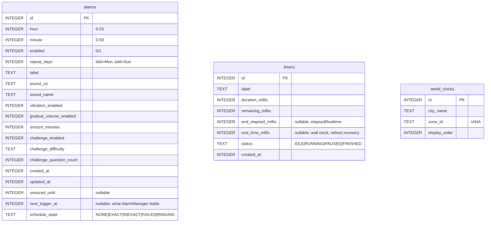

# Data storage

All persistent data lives on the device in **device-protected storage**
(`Context.createDeviceProtectedStorageContext()`), so the alarm engine can read it during Direct
Boot. `android:allowBackup="false"` and `data_extraction_rules.xml` exclude everything from cloud
backup and device-to-device transfer.

## SQLite — `rcb_wake.db` (schema version 1)

Owned by `WakeDatabase` (`SQLiteOpenHelper`, WAL enabled). Accessed only from Kotlin.

Stable ids: `INTEGER PRIMARY KEY AUTOINCREMENT`. Alarm ids double as PendingIntent request codes.

Migrations: `onUpgrade` is empty for version 1. Future schema changes must be additive and
non-destructive.

## SharedPreferences

| File | Key | Contents |
| --- | --- | --- |
| `rcb_wake_settings` | one key per `Settings` field | User preferences (see [native-contract.md](native-contract.md)). Defaults: Midnight Purple, system time format and language (falls back to English), "Dawn" tone, 10-min snooze, vibration and gradual volume on, challenge off, weather off, sleep reminder off. |
| `rcb_wake_state` | `active_session` | Ringing session JSON (alarm ids, start time, challenge requirements). |
| | `pomodoro`, `pomodoro_boot_count` | Pomodoro state JSON and boot count. |
| | `timers_boot_count` | Boot count when timers were last scheduled. |
| | `weather_snapshot` | Last weather reading (temperature, condition, day/night, time, source). |
| | `location_lat`, `location_lon`, `location_at` | Coarse device location (2 decimals) when "use my location" is on. Cleared when it is turned off. |
| | `js.stopwatch` | Stopwatch state written by JS (monotonic times + boot count). |
| | `js.challenge_progress` | Current challenge question and progress; cleared with the session. |

## Synchronisation contract

1. JavaScript never writes storage directly; it calls the module.
2. Every engine mutation persists before scheduling and records the scheduling result.
3. The engine emits an event after each change; JS stores reload from the engine.
4. Receivers and services read the same stores, so ringing never needs JavaScript.
